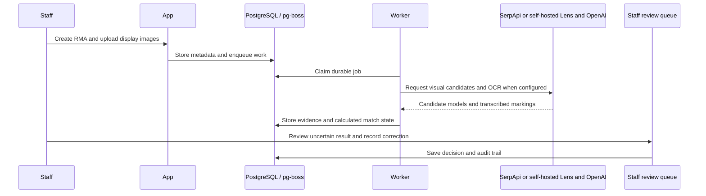

# Architecture

## Runtime components

- **Next.js App Router:** interface and route handlers for authentication, RMA workflows, catalogs, reports, and image delivery.
- **PostgreSQL:** users, sessions, customers, RMA records, catalog data, vendor rules, recognition results, audit records, settings, and the durable job queue.
- **pg-boss worker:** processes queued image recognition independently from HTTP requests.
- **Private image volume:** stores original uploads and derived previews outside the web root. Image reads go through authenticated handlers.
- **Reverse proxy:** terminates HTTPS and forwards requests to the app. Caddy is available as an optional Compose profile.
- **External adapters:** SerpApi or the reversible self-hosted Lens-compatible adapter provides visual search; OpenAI Vision extracts visible text. Local build and mock-backed tests do not require either provider.

## Recognition flow

## Data boundaries

- Upload bytes and catalog workbooks are operational data and stay outside the public source repository.
- Provider keys, session secrets, and database credentials are runtime secrets. Do not prefix them with `NEXT_PUBLIC_`.
- Mock adapters are restricted to development and test environments by runtime guards.
- Production and CI use separate databases, storage, credentials, and worker instances.
- A fresh installation has no customer or RMA fixtures. Import organization-specific catalog data privately after deployment.

## Persistence

Compose defines separate named volumes for PostgreSQL and uploaded images. Backups must include both. A copy on the same VPS is not off-site recovery. Encrypt off-server copies and test restores before deleting older recovery points.
