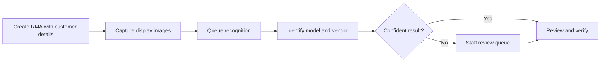
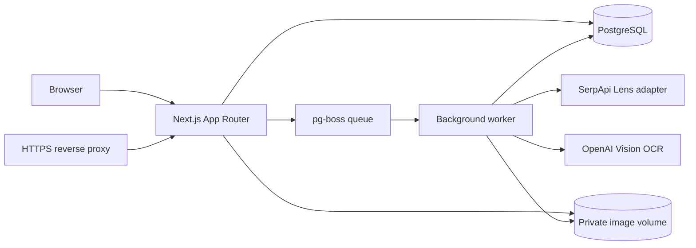

# RMA Display Identification System

[](https://github.com/arslanbasharat-o-o/RMA-System/actions/workflows/ci.yml)

A self-hosted application for receiving returned mobile display assemblies, recording inspection images, and reviewing display-model and vendor-identification results. Recognition runs in a PostgreSQL-backed worker; staff review uncertain matches before treating them as verified.


*Dashboard preview with synthetic example records. The examples use placeholder customer, tracking, and vendor data; no customer display images are shown.*

## What it does

- Records customers, return reasons, RMA shipments, and individual display assemblies.
- Captures multiple views of a display with a mobile camera or file upload.
- Sends visual identification through a Google Lens-compatible SerpApi adapter and reads markings with OpenAI Vision OCR when configured.
- Runs recognition outside the web request in a durable `pg-boss` worker queue.
- Matches evidence against display and vendor catalogs, then routes uncertain results to a staff review queue.
- Supports administrator, operator, and viewer roles, with authenticated image delivery and reports.
- Keeps uploaded images in private persistent storage rather than in the public source tree.

Recognition providers are configurable. Local development and automated checks use mock providers and make no paid recognition requests.

## Intake flow



## Application preview

The repository includes additional screenshots for the RMA list, intake form, mobile camera flow, recognition review, vendor catalog, display catalog, and review queue. They use synthetic example records.

<details>
<summary>View selected screens</summary>

### RMA intake


### Mobile display capture


### Recognition review


### Vendor catalog


### Review queue


</details>

## Architecture

The Next.js App Router serves the interface and API routes. PostgreSQL stores operational records, audit evidence, and the durable queue. A separate worker processes recognition jobs and stores its results. Uploaded images live in a private Docker volume and are delivered through authenticated routes. Docker Compose describes the app, worker, database, and optional Caddy proxy.



See [ARCHITECTURE.md](ARCHITECTURE.md) for the data boundaries and processing flow.

## Quick start

You need Node.js 24, npm, and a local PostgreSQL 16 database. Create a disposable development database before running migrations or tests.

```bash
git clone https://github.com/arslanbasharat-o-o/RMA-System.git
cd RMA-System
npm ci
cp .env.example .env.local
```

Edit `.env.local` with the local database URL and a unique administrator password of at least 16 characters. Keep `LENS_PROVIDER=mock` and leave provider keys empty for offline development. Then load those values into the current shell and initialize the database:

```bash
set -a
. ./.env.local
set +a
npm run db:migrate
npm run db:seed
npm run dev
```

Run the background worker in another terminal after loading the same `.env.local` values:

```bash
set -a
. ./.env.local
set +a
npm run worker
```

See [CONTRIBUTING.md](CONTRIBUTING.md) for disposable test databases and browser checks. For Docker deployment, persistent storage, and backups, see [DEPLOYMENT.md](DEPLOYMENT.md).

## Checks

```bash
npm run typecheck
npm run lint
npm test
npm run build
```

Database-backed tests require an isolated PostgreSQL database and synthetic fixtures. The CI workflow provisions its own PostgreSQL service and uses mock recognition. Pull requests run the camera-intake browser checks in desktop Chromium and mobile Chrome; release validation runs the full Playwright suite in both projects. Never point tests at production or use a paid recognition provider for tests.

## Configuration and deployment

`.env.example` documents local-only placeholders. Keep runtime credentials in an untracked environment file or secret manager. Do not place real customer data, uploaded images, private catalog workbooks, database dumps, or API keys in Git.

The application is self-hosted. This repository does not deploy to a production host automatically; deployment and database changes require a separately reviewed release process. Follow [DEPLOYMENT.md](DEPLOYMENT.md) and preserve the existing database and storage volumes when updating an installation.

## Project status

The public repository has CI and a tag-based release workflow. No GitHub Release has been published yet. Current application version metadata is `0.2.0`; this repository update does not deploy or change a running installation.

## Security, contributing, and license

Read [SECURITY.md](SECURITY.md) to report a vulnerability privately. Contributions should follow [CONTRIBUTING.md](CONTRIBUTING.md).

This repository does not include a project license. Public visibility alone does not grant rights to use, modify, or redistribute the software. Third-party components remain under their respective licenses.
