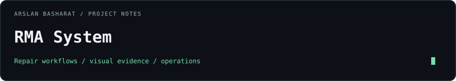

# RMA System



Repair operations software for return tracking, mobile display-photo intake, and evidence-based model review.

[Latest release](https://github.com/arslanbasharat-o-o/RMA-System/releases/latest) · [Deployment](DEPLOYMENT.md) · [Architecture](ARCHITECTURE.md) · [Security](SECURITY.md)

## What it does

- Tracks RMAs, return reasons, suppliers, warranties, and shipments.
- Captures display assembly photos from desktop and mobile workflows.
- Combines visual-search candidates, OCR markings, and AI vision inspection for model review.
- Processes image jobs through a PostgreSQL-backed queue with a separate worker.
- Keeps ambiguous matches available for 1-click technician review and ground-truth feedback.

## Stack

| Layer | Technology |
| :--- | :--- |
| Web application | Next.js 16, React 19, TypeScript, Tailwind CSS |
| Data and jobs | PostgreSQL 16, Drizzle ORM, pg-boss |
| Recognition | Self-hosted Google Lens API (v1.0.22 multisearch), AI vision inspection, and OCR |
| Delivery | Docker Compose and GitHub Actions (GHCR) |

## Run locally

Use the Node version in [`.nvmrc`](.nvmrc) and a local PostgreSQL database.

```bash
git clone https://github.com/arslanbasharat-o-o/RMA-System.git
cd RMA-System
nvm use
npm ci
cp .env.example .env.local
```

Configure `DATABASE_URL`, session secrets, and your initial administrator in `.env.local`. Use `LENS_PROVIDER=mock` for offline recognition development. Keep real credentials outside Git.

```bash
npm run db:migrate
npm run db:seed
npm run dev
```

Run `npm run worker` in a second terminal. Open `http://localhost:3000`.

## Preview


<details>
<summary>More screens</summary>


</details>

## Validate

```bash
npm run typecheck
npm run lint
npm test
npm run build
```

## Releases and deployment

The source version is defined in [`package.json`](package.json). Use the [latest published release](https://github.com/arslanbasharat-o-o/RMA-System/releases/latest) (currently v0.4.8) and its matching image tags when deploying. Application and worker images must use the same release version; see [the release process](docs/release-process.md).

Deployment, migrations, volumes, and backups are documented in [DEPLOYMENT.md](DEPLOYMENT.md) and [docs/DEPLOYMENT.md](docs/DEPLOYMENT.md). A passing local test does not establish live provider availability or deployment status.

## Documentation

- [System architecture](ARCHITECTURE.md)
- [Production deployment and rollback](docs/DEPLOYMENT.md)
- [Self-hosted Lens integration](docs/self-hosted-lens.md)
- [Recognition evaluation](docs/recognition-evaluation.md)
- [Release process](docs/release-process.md)
- [Contribution guide](CONTRIBUTING.md)
- [Security policy](SECURITY.md)

## License

[MIT](LICENSE).
