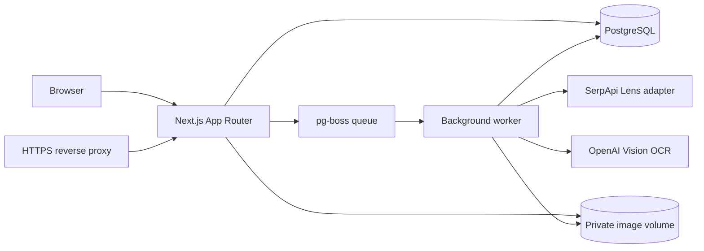
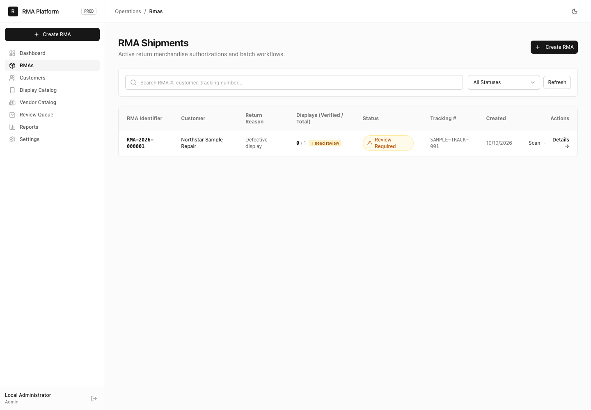
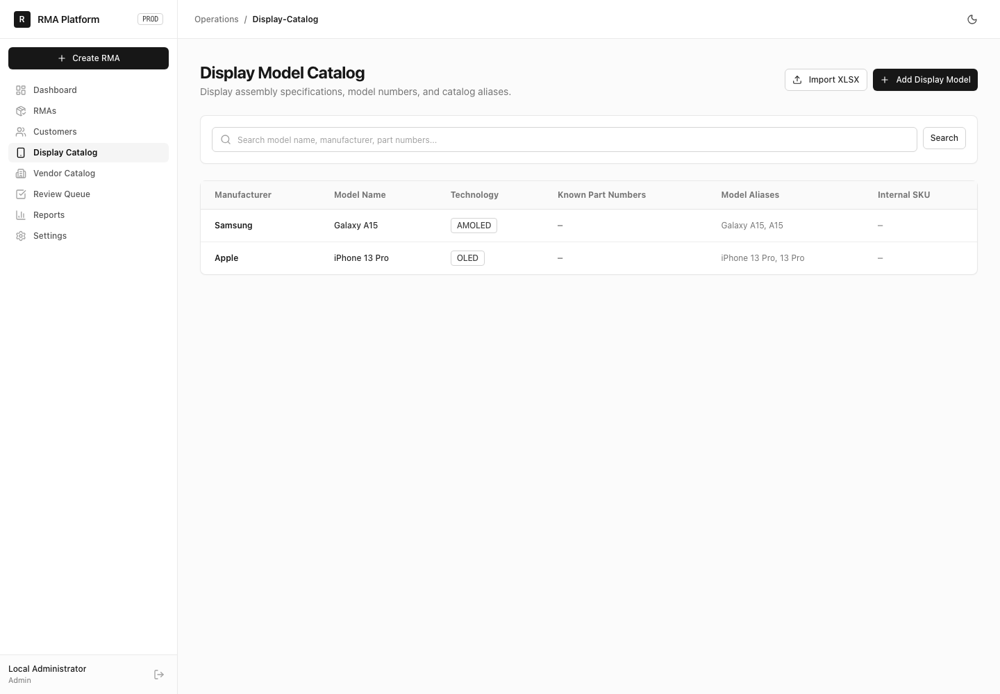

# RMA Display Identification and Management System

A self-hosted operations system for receiving returned mobile display assemblies, organizing intake, capturing inspection images, and reviewing model and vendor identification candidates.

The application separates visual model identification from printed-marking OCR. It stores images privately, processes recognition work in a PostgreSQL-backed queue, and leaves uncertain results for staff review.

## Features

- Create and manage RMAs, customers, return reasons, display items, and reports.
- Use a mobile camera scanner to capture several views of each physical display.
- Import and manage a display model catalog from the admin interface or a private workbook.
- Send visual searches through a Google Lens-compatible SerpApi adapter.
- Read labels and markings with OpenAI Vision, then match results against vendor and variant rules.
- Process recognition in a background worker and review ambiguous results in a staff queue.
- Enforce admin, operator, and viewer access at API boundaries.
- Store uploads in a private Docker volume and serve them through authenticated routes.
- Run on Docker Compose with PostgreSQL and an optional Caddy reverse proxy.

Mock recognition is for development and tests. Production rejects mock visual recognition and mock OCR.

## Architecture



See [ARCHITECTURE.md](ARCHITECTURE.md) for boundaries and data flow.

## Prerequisites

- Node.js 24
- PostgreSQL 16 or Docker Compose
- npm

## Local development

```bash
git clone https://github.com/arslanbasharat-o-o/rma-display-management-system.git
cd rma-display-management-system
npm ci
cp .env.example .env.local
set -a && source .env.local && set +a
```

Edit `.env.local` with a local PostgreSQL URL and a generated session secret. Keep `LENS_PROVIDER=mock` and provider keys empty for offline development. Set a unique `INITIAL_ADMIN_PASSWORD` of at least 16 characters before seeding.

```bash
npm run db:migrate
npm run db:seed
NODE_ENV=test npm run test:fixtures
npm run dev
```

Run the worker in another terminal with the same local `.env.local`:

```bash
npm run worker
```

Database seeding creates the configured administrator, standard return reasons, settings, and catalog rows only when a private `data/catalog.xlsx` workbook is supplied. The workbook is excluded from Git and Docker build contexts. Administrators can import a catalog through the app.

## Validation

```bash
npm run typecheck
npm run lint
npm test
npm run build
```

Vitest integration cases use a disposable PostgreSQL database. Run `NODE_ENV=test npm run test:fixtures` before tests; it loads only synthetic catalog and vendor fixtures and refuses to run outside test mode. Never point tests at production. Playwright tests also require a disposable database seeded from `INITIAL_ADMIN_EMAIL` and `INITIAL_ADMIN_PASSWORD`; they use mock recognition. GitHub Actions runs type checking, linting, Vitest, and a production build with an ephemeral database. It makes no paid provider calls.

## Deployment

See [DEPLOYMENT.md](DEPLOYMENT.md). Production needs separate secrets, persistent PostgreSQL and image volumes, and an HTTPS reverse proxy. The repository has no automatic production deployment workflow.

## Screenshots

These screenshots were captured from the actual application using a disposable local database, synthetic records, a synthetic display image, and mock recognition. They contain no production records or provider credentials.

<details>
<summary>Open the screenshot tour</summary>

### Operations dashboard


### RMA listing



### Create an RMA


### Camera scanner


### Recognition review


### Vendor catalog


### Review queue


### Display catalog



</details>

## Security and licensing

Read [SECURITY.md](SECURITY.md) before reporting a vulnerability. The repository has no license file; public visibility does not grant permission to use or redistribute the software. Third-party components retain their own licenses.
