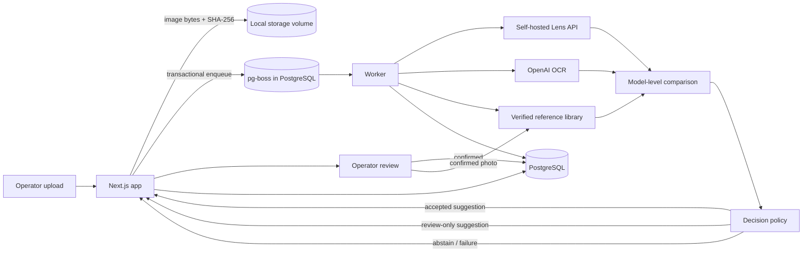

# Recognition architecture

> Deployment-specific model settings, coverage, and benchmark figures below are historical observations, not verified current production state. Check current code and runtime before relying on them.

## Purpose

The recognition pipeline turns uploaded display photos into an evidence-backed
catalog suggestion. It does **not** auto-verify an item. Operator confirmation is
the only path to a verified item, and verified items become the reference library
used by later uploads.

## Components

| Component | Responsibility |
| --- | --- |
| Next.js app | Intake, authentication, upload storage, review UI, API, transactional queue publish. |
| PostgreSQL | Business records, catalog, verified items, part-number feedback, `pg-boss` queue, recognition audit. |
| Worker | Consumes `process-rma-item` jobs, runs Lens and OCR in parallel, loads verified references, applies the decision policy, persists results. |
| Local storage volume | Original uploads, thumbnails, previews, and reference photos. |
| Self-hosted Lens API | Independent visual search candidates and source titles. |
| OpenAI OCR (`gpt-4o` in this deployment) | Text, part-number, vendor, and marking extraction. The model is read from the `OPENAI_VISION_MODEL` app setting at runtime; the environment variable is the fallback. |
| OpenAI reference comparison (`gpt-6.1-sol`) | Compares the upload against operator-verified reference photos and returns a catalog selection, confidence, cues, and caveats. |

## Data flow

## Runtime configuration

The visual comparator uses the server environment setting
`OPENAI_REFERENCE_MODEL=gpt-6.1-sol`. OCR uses the `OPENAI_VISION_MODEL` value
stored in `app_settings`; this deployment currently has `gpt-4o` there, which
takes precedence over the environment variable. The benchmark and live replay in
this release were measured with that OCR configuration. Changing the OCR model
requires a fresh benchmark and live replay rather than assuming equivalent
behavior.

## Recognition sequence

1. The app stores the uploaded image and its checksum, then publishes a job in
   the same database transaction that marks the item `queued`.
2. The worker loads the item and all attached images, then runs two independent
   evidence streams:
   - Lens search for candidate listings;
   - OpenAI OCR for text, part numbers, vendor markings, and technology marks.
3. Candidate catalog IDs are ranked from Lens titles, aliases, and verified
   part-number evidence. Exact part-number matches remain authoritative.
4. The verified library is searched by device model, not just by the exact
   catalog assembly. Candidate SKUs are normalized to a model key; the shortlist
   prefers the SKU proposed by search when that SKU has a verified photo, and
   otherwise uses a verified sibling assembly of the same model.
5. Discovery shortlists the verified library in one compact, low-effort pass
   when the library has at most 32 models; larger libraries use bounded batches.
   Discovery sends the focused sensor/notch view of every reference with a
   low-detail context frame, so it can compare many models without paying the
   full high-detail cost. A final high-detail comparison then runs against the
   discovery winner plus the closest search-ranked alternatives, with up to two
   independent verified items per model. Every target photo checksum is excluded
   from the reference set.
6. The comparison returns a selected catalog ID, a confidence score, concrete
   matching cues, conflicting cues, unresolved alternatives, and cited reference
   item IDs. Corroboration is counted per **device model**: the XR `AM` and `COF`
   assemblies are two independent references for the same iPhone XR model.
7. The policy decides whether to apply the comparison to the item, show it only
   as a review suggestion, or abstain. The item is always persisted with an
   auditable `recognition_runs` record containing the candidate IDs, reference
   item IDs, model-level reference count, cues, and caveats.
8. An operator reviews the suggestion in the app. Confirming the model marks the
   item verified and makes its photos and part numbers eligible for future
   reference comparison and part-number learning.

## Comparison latency

The normal comparison path makes two provider calls: one compact discovery call
and one high-detail final call. Discovery sends a low-detail context frame plus
the focused sensor/notch crop for every reference, requests only the selected
catalog ID and confidence, and uses low reasoning effort. The final call keeps
the v0.4.0 high-detail frames, full cue schema, and medium effort. Prepared
frames are cached per image buffer, and every batch in a large-library discovery
round runs concurrently.

On the frozen 12-model holdout with 26 verified models, the comparison stage
measured p50 **28.0 s** (discovery 12.3 s + final 13.9 s) and p95 **37.9 s**.
Including Lens search and reference loading, the benchmark case measured p50
**39.1 s** and p95 **52.8 s**. Stage timings are persisted in
`recognition_runs.raw_response.timings`.

## Decision policy

### Accepted suggestion

The comparison is applied when all of the following hold:

- a catalog model was selected;
- the selected ID is in the supplied candidate set;
- confidence is at least **0.93**;
- the selected model has at least one verified reference;
- corroboration is one of:
  - at least **two independent verified items** for the same device model, or
  - one reference plus independent Lens agreement, or
  - a decisive single-reference match (at least **0.97**, at least **three**
    matching cues, and no unresolved alternative);
- unresolved alternatives block a single-reference match unless the decisive
  exception applies. Two model-level references can outweigh a residual caveat
  that the comparison already considered and rejected.

### Review-only suggestion

When the comparison selects a reference-backed model but does not meet the
accepted-suggestion policy, the model stays visible for the operator instead of
being replaced with an empty "unidentified" result. The item remains
`review_required`; this is explicitly not a verified decision.

| Evidence | Minimum confidence |
| --- | --- |
| One reference, no unresolved alternative | 0.85 |
| One reference, unresolved alternative | 0.90 |
| Two or more model-level references | 0.80 |

At least two concrete matching cues are always required. Unresolved alternatives
are shown to the operator, not hidden. The suggestion never marks an item
verified.

### Abstain

If no reference-backed model passes either policy, or providers fail, the item is
left unidentified / `review_required` rather than guessing. A failed Lens or OCR
stream is not converted into a model match.

## Why model-level grouping

Catalog assemblies are commercial variants, not different devices. iPhone XR
`AM` and `COF` are the same phone model; iPhone 11 `AM`, `COF`, and `Incell` are
the same phone model. Counting references per SKU forced the engine to demand two
references for the exact assembly, which under-counted operator evidence and
caused a correct XR comparison to be withheld. Grouping by model fixes the
evidence count while preserving the exact SKU when it has its own verified photo.

## Audit and safety invariants

- No automatic item verification; operator confirmation is required.
- Target images are excluded by checksum, even if the same photo was previously
  attached to a verified item.
- A contradictory verified part number withholds model identification.
- Provider failures and low-confidence comparisons fail closed to review. A
  transient 5xx during reference comparison is retried once; a persistent
  failure still leaves the item in review instead of guessing.
- Scores are policy evidence scores, not calibrated probabilities.
- Reference photos are retrieval-time examples; no model weights are changed.
- The recognition run records the model-level reference count so a later audit
  can distinguish "one SKU" from "two assemblies of one model".

## Current coverage and limits

The verified library is intentionally sparse: at the time of this release it
contains 32 active catalog SKUs covering 26 device models, against 2,443 active
catalog rows and 1,739 distinct model names. A model with no verified reference
cannot receive a reference-backed confirmation. Photo-only comparison also cannot
separate physically identical variants when the photo lacks distinguishing
evidence (for example 120 Hz versus non-120 Hz panels); those cases remain
`review_required` with explicit unresolved alternatives.

The full-library strategy is appropriate for the current small reference set.
Measured growth or unacceptable latency should trigger image-embedding retrieval
before comparison.
